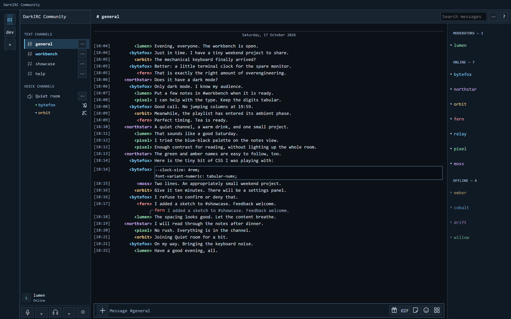

# DarkIRC

DarkIRC 1.0.6 is an unofficial IRC-style Discord theme for Vencord, with a blue-black palette, monospace text, aligned timestamp/nickname columns and compact controls. It builds on [Compact++](https://git.stary.pc.pl/Grzesiek11/compactpp) by Grzesiek11.



*Synthetic preview rendered from the theme’s test layout; all server names, usernames, and messages are fictional.*

- Consistent message columns, visible timestamps and restrained hover/selection colors.
- Long names stay truncated on hover and keyboard focus. Open the native user profile to read the full name.
- An avatar-free member list, indented 22 px voice participants without avatars or server tags and a two-row account panel.
- Role colors and optional IrcColors colors are preserved; display-name glow and decorative typography are simplified.
- One standalone CSS file, without remote imports, images or downloaded fonts.

## Install

1. Use desktop Discord with [Vencord](https://vencord.dev/) already installed. Review the terms notice below before using client modifications.
2. Download **DarkIRC.theme.css** from this repository's release assets, or build it from source as described below.
3. Open **User Settings → Vencord → Themes → Local Themes → Open Themes Folder**. Copy `DarkIRC.theme.css` into that folder, then enable DarkIRC under Local Themes.
4. Set Discord's **Message Display** to **Compact** in its appearance/chat settings. This is required for the IRC column layout.
5. Optionally enable **IrcColors** under **Vencord → Plugins** for per-user nickname colors. It is a separate Vencord plugin and is not bundled here.

DarkIRC includes the relevant Compact++ layout code. Enable DarkIRC on its own; stacking other layout themes can cause conflicts.

## Update or remove

To update, keep a copy of your current CSS outside the themes folder, then replace `DarkIRC.theme.css` with the new release asset. Local Themes updates are manual. If the change does not appear, toggle DarkIRC off and on. Restore the saved CSS to roll back.

To remove, disable DarkIRC under Local Themes and delete its CSS file from the folder opened by **Open Themes Folder**. Other themes and Discord settings do not need to change.

## Known limitations

- The right member list retains Discord's native **42 px rows** in the tested desktop layout. Discord's JavaScript virtualizer controls row offsets, spacer sizes and member loading. CSS-only row shrinking cannot keep those calculations synchronized, so DarkIRC preserves their geometry. Client updates or density settings may change native dimensions.
- Full names use Discord's native profile controls. No custom tooltip or script is injected. Native click and keyboard targets remain intact.
- Discord changes internal CSS classes frequently. Updates, experiments, unusual badge/name structures and third-party plugin combinations may need fixes. Very narrow chat panes stack metadata above message content.
- The member marker distinguishes offline rows; it does not show precise idle/DND status. Role colors, IrcColors colors and offline dimming can affect contrast.
- Browser fixtures simulate layout and interactions; they do not prove Discord's virtualizer or React behavior. Desktop checks cover a limited set of states.

## Build

Requires Node.js. No dependency installation is needed:

```sh
node scripts/build.cjs
```

Edit the numbered modules in `src/`; the build concatenates them and embeds the complete Compact++ license into `DarkIRC.theme.css`. The public distribution contains theme sources, the build script and documentation. Development history, runtime CSS, captured conversations and internal validation artifacts are excluded.

## Credits and license

**Compact++ 1.9.3:** Copyright © 2023–2026 **Grzesiek11**, licensed under **BSD-2-Clause-Patent (BSD+Patent)**. Original source: [Grzesiek11/compactpp](https://git.stary.pc.pl/Grzesiek11/compactpp). Its modified layout code is in `src/05-compactpp.css`. DarkIRC retains its column, reply, attachment, system-message and plugin compatibility rules, retains the AutoMod action control, and removes expanding name/pronoun hover popups.

**DarkIRC's original additions:** Copyright © 2026 **DarkIRC contributors**, also licensed under **BSD-2-Clause-Patent**. These comprise the other source modules and build script. See [LICENSE](LICENSE), [the complete Compact++ license and attribution](licenses/Compact++-BSD-Patent.txt), and [THIRD_PARTY_NOTICES.md](THIRD_PARTY_NOTICES.md). The upstream license's template copyright line is preserved verbatim alongside its actual attribution.

No Discord or Vencord program code, logos, fonts, avatars or other graphical assets are distributed. CSS selectors and variable names identify compatibility interfaces. IrcColors is referenced for optional integration; its implementation is not included.

## Compatibility and terms

DarkIRC is an **unofficial Discord appearance theme**, neither endorsed nor maintained by Discord or Vencord. Client modification is not officially approved. [Discord's Terms of Service](https://discord.com/terms) restrict modifying its software and using unauthorized software to modify its services; client modifications can violate those terms and may put an account at risk. Review the current terms and make your own decision before use. Compatibility is provided on a best-effort basis, without warranty.
